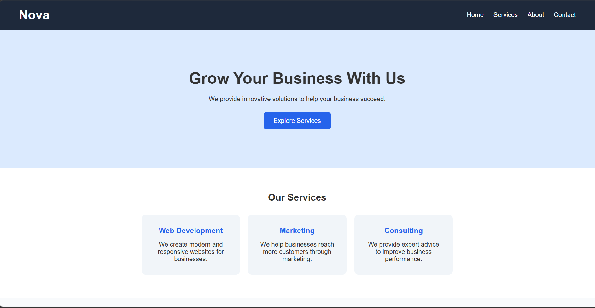

# Ex02 Commercial Website
## Date:20/11/2026

## AIM
To create a commercial website using CSS Flexbox.

## ALGORITHM
### STEP 1
Create an HTML file (index.html)

### STEP 2
Create a CSS file (style.css)

### STEP 3
Include a navigation bar with links to different sections.

### STEP 4
Add structured sections for Homepage, Products / Services, About Us, Contact Details and User Account.

### STEP 5
Include social media links at the footer with copyright information.

### STEP 6
Define global styles for fonts, colors, and layout.

### STEP 7
Style the header, navigation bar, and sections.

### STEP 8
Use Flexbox for layout design.

### STEP 9
Add hover effects and transitions for interactivity.

### STEP 10
Add Images and Media.

### STEP 11
Use optimized images for a professional look.

### STEP 12
Open the HTML file in a browser to check layout and functionality.

### STEP 13
Fix styling issues and refine content placement.

### STEP 14
Deploy the website.

### STEP 15
Upload to GitHub Pages for free hosting.

## PROGRAM
```

<!DOCTYPE html>
<html lang="en">
<head>
    <meta charset="UTF-8">
    <meta name="viewport" content="width=device-width, initial-scale=1.0">
    <title>Nova Business</title>
    <link rel="stylesheet" href="style.css">
</head>
<body>

    <header>
        <nav class="navbar">
            <h1>Nova</h1>
            <div class="nav-links">
                <a href="#">Home</a>
                <a href="#services">Services</a>
                <a href="#about">About</a>
                <a href="#contact">Contact</a>
            </div>
        </nav>
    </header>

    <section class="hero">
        <div class="hero-content">
            <h2>Grow Your Business With Us</h2>
            <p>We provide innovative solutions to help your business succeed.</p>
            <a href="#services" class="btn">Explore Services</a>
        </div>
    </section>

    <section id="services" class="services">
        <h2>Our Services</h2>
        <div class="service-container">
            <div class="card">
                <h3>Web Development</h3>
                <p>We create modern and responsive websites for businesses.</p>
            </div>
            <div class="card">
                <h3>Marketing</h3>
                <p>We help businesses reach more customers through marketing.</p>
            </div>
            <div class="card">
                <h3>Consulting</h3>
                <p>We provide expert advice to improve business performance.</p>
            </div>
        </div>
    </section>

    <section id="about" class="about">
        <h2>About Us</h2>
        <p>Nova is a business company focused on delivering quality services, building strong relationships and helping customers achieve their goals.</p>
    </section>

    <section id="contact" class="contact">
        <h2>Contact Us</h2>
        <p>Email: info@nova.com</p>
        <p>Phone: +91 9876543210</p>
    </section>

    <footer>
        <p>&copy; 2026 Nova Business. All Rights Reserved.</p>
    </footer>

</body>
</html>


```

## OUTPUT


## RESULT
The program for creating commercial website using CSS Flexbox is executed successfully.
